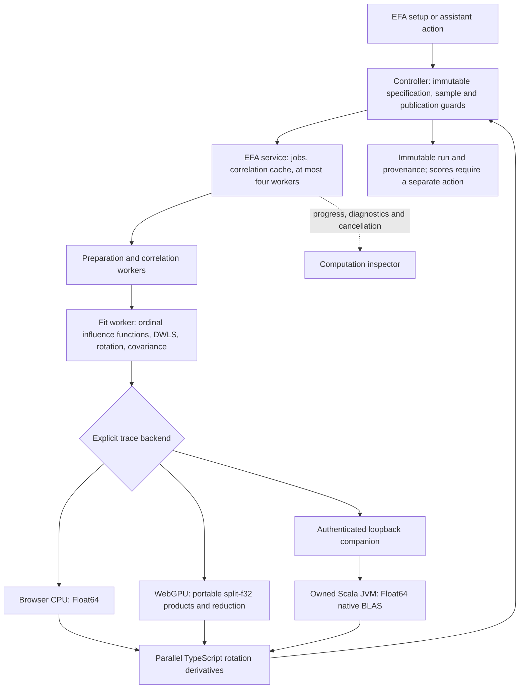

# EFA compute backends

The EFA setup exposes **Browser CPU**, **WebGPU**, and **Scala** when extraction is WLSMV. The selected accelerator computes the exact case-space trace blocks used by the WLSMV correction. Ordinal preparation, polychoric correlations, DWLS point fitting, covariance construction, rotations, rotation derivatives, and scores remain in the shared TypeScript engine. PCA is unchanged.



## Using the selector

1. Open **EFA**, review the items and sample, and choose **WLSMV**.
2. Choose the trace backend. CPU remains the default. WebGPU needs a hardware adapter supported by the browser and a secure origin (localhost is supported); it requires no developer flags. Scala needs the local companion described below.
3. Optionally adjust block rows and the inference allocation budget, then preview the sample and run. All three backends support 32/64/128/256 rows. WebGPU keeps 128 as its default; 256 uses more device memory and is not assumed to be faster. Defaults are 128/1536 MiB for WebGPU, 256/1536 MiB for Scala, and 32/1024 MiB for CPU. The budget is an inference allocation estimate, **not a cap on total browser, GPU or JVM memory**.
4. Open **Compute** to see progress, stage timings, the selected trace kernel, precision, device/runtime, self-check result, and kernel hash. **Cancel job** terminates browser workers and requests termination of the owned Scala process. The inspector records whether native exit was acknowledged. Worker termination timing does not establish GPU retirement timing.

Each accelerated fit first runs five deterministic synthetic block checks against the compensated Float64 CPU oracle, at scaled error tolerance `1e-10`. The checks exercise mixed categories, missing cells, multiple dot chunks, offsets, tails, and the selected block size. Real analysis data is supplied to the accelerator only after these checks pass. Failure stops the job; there is no automatic backend or estimator substitution.

Completed runs retain the selected settings and execution provenance. Refits, rotation comparisons, and structure replication inherit the saved compute specification. Existing runs without compute settings use CPU. Workspace import validates accelerated provenance and rejects failed/missing self-checks and connection credentials in compute settings. Connection details are never part of a saved run.

Accelerated MICE and resampling jobs are explicitly rejected in this release; select CPU for those workflows. Parallel analysis and scoring continue to use their existing browser implementations. A backend selection does not accelerate every stage of EFA.

## Scala companion

From `frontend/`, using Node and Java 21 or newer:

```sh
npm run efa:companion:setup
npm run efa:companion -- --origin=http://localhost:3000
```

For local app development, start the app with `dev start frontend --detach --json --yes` from the repository root. Match `--origin` to the exact origin printed by the launcher. For another deployed workbench origin, supply its exact HTTPS origin instead.

Setup downloads only the pinned Scala 2.13.16 and netlib BLAS 3.2.0 dependencies listed in `frontend/scripts/efa-companion/dependencies.json` and verifies their SHA-256 hashes. It does not run during a fit. Java and a compatible native BLAS installation are prerequisites; the companion refuses a Java BLAS fallback. On macOS it uses Accelerate. This integration was exercised on macOS; Linux/Windows native-library discovery still needs system-specific qualification.

The companion prints a loopback URL and a fresh pairing token. Paste these into the Scala controls and click **Connect local companion**. Pairing is held in application memory only; reload requires pairing again. The browser may request local-network access. You can change the operator settings with `--port=8787`, `--threads=1|2|4`, and `--cache=/path/to/verified/dependencies`.

The supervisor binds only `127.0.0.1`, verifies the exact Host and Origin, and requires its random token on every non-preflight request. The browser client rejects nonliteral loopback targets, credentials in URLs, redirects, and URL paths/queries. The API exposes only health, job lifecycle, source initialization, bounded trace blocks and heartbeat. It cannot execute a supplied command, class, path or benchmark probe. The browser encodes and sends the source in bounded 4 MiB chunks, with sequential offsets and an explicit completion check. Source initialization is capped at 512 MiB; blocks at 256 rows per side; one job and one numerical request are active at a time. Binary dimensions, lookup ranges, codes and finite values are checked before native evaluation.

The supervisor starts a fixed Scala class with pinned dependencies and a limited environment. It owns the process lifetime, waits for exit on deletion, and escalates from SIGTERM to SIGKILL after 400 ms if needed. Cancellation also covers startup and incomplete uploads. A 120-second lease and eight-hour maximum lifetime stop abandoned jobs. The main thread renews the lease every 15 seconds. Long browser suspension can therefore require an explicit refit. The JVM is released before rotation derivatives begin. This is a local trusted-code boundary, not an OS sandbox against another process running as the same user.

## Qualification and limits

Checkpoint `525a50d` retains the preceding full-size numerical and performance evidence. The integration adds browser workflow checks using the actual EFA service and worker, actual application UI checks in both themes, offline assistant replays, persistence checks, malformed transport tests and inspector cancellation checks. Evidence is in `frontend/scripts/efa-companion/evidence/`.

`qualify-browser.mjs` fits the five existing independent R-reference datasets with all three rotations on CPU, WebGPU and Scala, comparing accelerated output with the R-qualified CPU implementation. Existing R-parity unit checks remain in place with their original tolerances. The workflow checks use standard Chrome flags. A full-size single-request Scala upload timed out during integration; its evidence is retained. The final bounded-chunk transport passed the scale check without loosening numerical thresholds. `check-large-transport.mjs` transfers the full 500 × 20,000 synthetic resident source and evaluates one selected-size block on each accelerator, with three sampled Float64 controls. It is **not a new full-fit performance benchmark**.

Reproduction scripts use a temporary `/tmp/scatter-efa-companion-pairing.json` file for the automated local browser tests; this is test infrastructure, not application persistence. Keep that file private and remove it after stopping the test companion. Tests and qualification inputs are public/synthetic. No participant data or paid assistant-provider calls are used.

To reproduce the integration checks, run the companion directly in a dedicated terminal after setup (from `frontend/`):

```sh
umask 077
node scripts/efa-companion/server.mjs --origin=http://localhost:3000 > /tmp/scatter-efa-companion-pairing.json
```

In another terminal, with the app ready through `dev`, run `node scripts/efa-companion/qualify-browser.mjs`, then `node scripts/efa-companion/check-boundary.mjs`. The UI and cancellation scripts accept `webgpu` or `scala` as their argument. Run companion checks sequentially: the companion deliberately allows only one job at a time. `node scripts/efa-companion/check-large-transport.mjs` uses the generated browser assets and exercises the full resident-source size. Stop the test companion and remove its pairing file afterward.

Rotation comparisons and repeat WLSMV fits reuse a bounded, tab-local cache of the unrotated extraction, ordinal uncertainty summary, canonical covariance, and robust test. The cache holds at most two entries and 128 MiB, and includes the table revision, selected rows/items/transformations, factor count, estimator, engine, and normalized backend settings in its key. It retains completed jobs only. Rotation and rotation-dependent standard errors are recomputed. The inspector and exported execution provenance identify the originating job; a reused self-check is not presented as a new GPU execution. GPU buffers are still released after inference, and this cache is not serialized in workspaces.

## Estimated MV option

See [Estimated MV correction](EFA-ESTIMATED-MV.md) for the optional WebGPU matrix-product path, probe settings, uncertainty, nonmodal inspector, cache/persistence behavior and measured speed–precision tradeoff. Exact remains the default on every backend. CPU and Scala retain exact correction.
