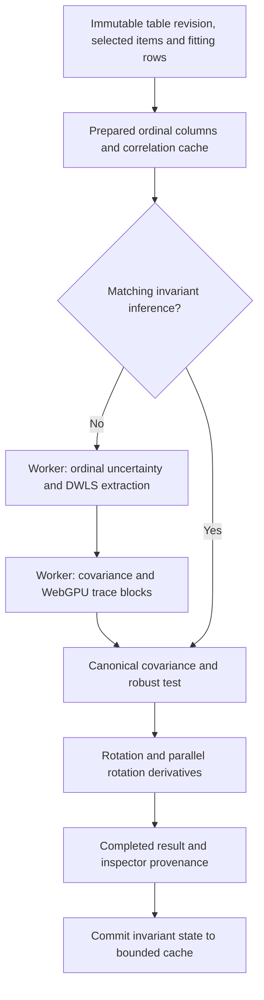

# WLSMV cache and GPU layout investigation

The application now reuses rotation-independent WLSMV inference within a tab. The production GPU loader remains columnar and the default block size remains 128. A 256-row option is available, with the same numerical checks. Cooperative loading and respondent-major GPU packing remain explicit harness experiments because the paired tests did not establish a useful speed advantage.

## Data flow and cache ownership



The new cache contains the unrotated extraction, ordinal sampling-variance/weight summaries, identified loading coordinates, canonical parameter covariance, robust test, inference plan, and original execution/self-check provenance. It does not contain respondent projections or GPU buffers. It is limited to two entries and 128 MiB with least-recently-used eviction. Oversized covariance transfers are skipped. Its contents are ephemeral and never serialized into a workspace.

Reuse requires the same immutable table revision, prepared fingerprint, item order/category order/reverse keys, missingness setting, eligible rows, factor count, estimator, engine, and normalized compute settings. Explicit extraction reuse must also agree with the cached extraction. Label, rotation, and rotation seed may change. Privacy support checks run before reuse. Cache insertion occurs only when the job commits as completed; cancellation and failure cannot commit new state. The cache owns separate data from mutable result objects returned to callers.

A cache hit recomputes the rotation, rotated standard errors, reproduced matrices, and scoring weights. It keeps the originating job ID and self-check, omits fresh kernel timings, and tells the inspector that no new trace kernel ran. Changing backend or block/budget settings invalidates this inference cache. Existing correlation reuse remains available.

The GPU kernel additionally caches the resident source's byte estimate and bind groups when buffer identity and binding sizes are unchanged. The old path rescanned all 124,750 pair lookups for memory budgeting on every block. Buffer growth and shape changes invalidate binding reuse. Actual source contents are still uploaded once per source identity and buffers are destroyed after inference.

## Why dot products dominate

For 500 items, there are 124,750 item-pair influence columns. With 20,000 respondents and five factors, the correction computes blocks of `H = A A' - Z Z'`, where A is implicitly 20,000 × 124,750 and Z is 20,000 × 2,490. About 200 million lower-triangle respondent pairs each need a 124,750-term dot product: approximately 24.95 trillion influence products, plus the projection products. A fully expanded Float64 A would occupy about 19.96 GB; we generate its values from ordinal codes and small lookup tables instead.

The portable shader represents each input using two f32 values. Each term uses product-error recovery and compensated accumulation with explicit rounding boundaries. Counting the source expressions gives approximately 22 floating-point operations per accumulated product, plus integer rounding operations, addressing, and synchronization. That is an expression count, not a hardware instruction count or measured 22-fold slowdown. WGSL exposes f32 and f16 runtime floating-point types, not general f64 arithmetic: <https://www.w3.org/TR/WGSL/#floating-point-types>.

The retained full-fit v3 benchmark took 31.06 minutes on WebGPU versus 17.22 minutes for Scala/native BLAS. GPU trace processing took 22.95 minutes, with about 22.09 minutes of timestamped GPU work; the dot shader accounted for over 98% of that GPU time. `mapAsync` wait includes waiting for GPU execution and must not be added as separate transfer cost. The Scala baseline delegates multiplication to native Apple Accelerate BLAS through JNI; it is not a comparison against ordinary Scala multiplication loops.

Those are historical full-fit measurements, not a new full-fit result for this change. That batch benchmark already shared inference across its three rotations. The new service cache avoids repeating it across separate interactive runs; it does not erase the first fit's cost or retroactively shorten that benchmark.

## Paired measurements

M1, 8 GiB RAM, ordinary Chrome with no WebGPU/developer flags. All experiments use the same deterministic 500-item / 20,000-row resident source, dot chunk size 1024, and saved Float64 native reference outputs. Each of ten ranges is executed five times. The wall summary sums per-range medians after excluding each range's first call, then averages two runs in reversed execution orders. These are targeted kernel measurements, not full fits or evidence about all GPUs.

| GPU loading | Mean sum of warm range medians | Difference from current loader |
| --- | ---: | ---: |
| Current columnar | 906.825 ms | baseline |
| Cooperative column loading | 901.375 ms | 0.6% faster |
| Respondent-major GPU packing | 919.275 ms | 1.4% slower |

The original source is already item-major/columnar. The cooperative variant maps neighboring loading threads to neighboring respondents within an item and transposes the shared tile back for unchanged arithmetic. The respondent-major variant changes only the GPU code packing and lookup indexing; the prepared CPU source stays columnar. The projection matrix already uses respondent-major storage. All tested layouts returned bit-identical outputs for corresponding ranges. The observed differences do not justify changing the production loader.

For the block comparison, both implementations calculate the same ten 256-row output ranges; the 128-row configuration subdivides those ranges. It does not compare four times as much output against one block.

| Block rows | Mean sum of warm range medians | Peak owned GPU buffers |
| --- | ---: | ---: |
| 128 subdivisions | 3,584.150 ms | 455.72 MiB |
| 256 | 3,664.875 ms | 548.72 MiB |

The final paired runs vary: 256 is slower in one order and faster in the other, averaging 2.3% slower. It saves dispatches, not dot products. It needs 93 MiB more GPU buffers here. The reduction now uses a two-dimensional dispatch when needed, avoiding the 65,535-workgroup dimension limit at 256² outputs. Keep 128 as default; allow an explicitly selected 256 with device-budget checks.

The maximum scaled error across the large resident experiments was 6.115e-14 against the unchanged 1e-10 gate. Sparse/missing responses, offsets, diagonal/off-diagonal blocks, ragged tails, and returns to full buffers are included. `cache-layout-summary-v4.json` indexes all evidence; preliminary runs are retained separately from final paired runs. Exact output arrays are deduplicated into gzip-compressed Float64 archives with verified SHA-256 hashes, and executable worker archives are retained.

## Libraries and next investigation

`ml-matrix` 6.12.1 is already pinned and used for decompositions and linear solves. Its installed `Matrix.mmul` is JavaScript looping over Float64 values; it does not invoke native BLAS or WebGPU. It does not remove the implicit-matrix or precision costs of this trace computation. `ml-pca` uses ml-matrix SVD, covariance eigendecomposition, or NIPALS for PCA. It does not implement ordinal EFA, polychoric uncertainty, or WLSMV robust corrections: <https://github.com/mljs/pca/blob/main/src/pca.ts>.

The next useful kernel experiments should target the cost per product and occupancy: alternate register blocking or splitting the large influence reduction from the much smaller projection reduction. GPU timestamps locate the work but do not establish whether instruction latency, register pressure, memory access, or barriers dominate within the dot shader. The earlier expanded-panel and pre-split-tile experiments also failed to show a useful gain. Preserve the existing precision strategy and oracle gates while measuring any alternatives; do not assume a library or transpose alone changes the result.

## Verification and reproduction

- Production service/worker browser qualification: 45 complete small fits (five independent R-fixture inputs × three rotations × CPU / WebGPU128 / WebGPU256); 30 GPU/CPU comparisons pass, including cached rotations and actual JSON persistence validation. Maximum standard-error difference is 1.874e-16; maximum robust-statistic difference is 1.208e-13. Independent R parity remains covered by the unit suite.
- Actual UI: repeated fit uses cache; inspector distinguishes reused checks from new execution; both themes, 390px layout, Escape/focus containment, and diagnostic exports pass. At block256, cancellation acknowledgement was 133 ms and zero runs were published. This measures application acknowledgement, not GPU command retirement.
- Unit coverage includes cache bounds/eviction, mutation isolation, revision/row/preprocessing/factor/compute invalidation, privacy gates on reuse, failed/cancelled jobs, cancellation of a cache hit, and backend provenance persistence.
- Final checks: 672 unit tests passed / 4 skipped; 59 assistant replay tests passed; TypeScript and the isolated production build passed. The lint regression gate found no new findings against the existing 117 errors / 6 warnings. Evidence is retained in `frontend/scripts/efa-reference/compute/cache-verification-v4/audit.json`. No full JavaScript CPU baseline was run, no companion server was needed, and no private data or paid provider calls were used.

From `frontend/`, after `dev start frontend --detach --json --yes` from the project root:

```sh
node scripts/efa-reference/compute/build.mjs
cp scripts/efa-reference/compute/native-resident-reference.json public/efa-qualification/compute/optimization-reference.json
cp scripts/efa-reference/compute/throughput-native256-v3.json public/efa-qualification/compute/optimization-reference-256.json
node scripts/efa-reference/compute/check-pipeline.mjs 'http://localhost:3000/efa-qualification/compute/index.html?optimization=true&mode=resident&backend=gpu-portable-reduced&loading=cooperative&chunk=1024' NEW-REPORT.json
node scripts/efa-reference/compute/check-pipeline.mjs 'http://localhost:3000/efa-qualification/compute/index.html?optimization=true&mode=resident&backend=gpu-portable-reduced&loading=columnar&chunk=1024&block=256&subBlock=128' NEW-BLOCK-REPORT.json
node scripts/efa-reference/compute/qualify-cache.mjs NEW-WORKFLOW-REPORT.json
node scripts/efa-reference/compute/check-cache-ui.mjs http://localhost:3000 NEW-UI-DIRECTORY
```
