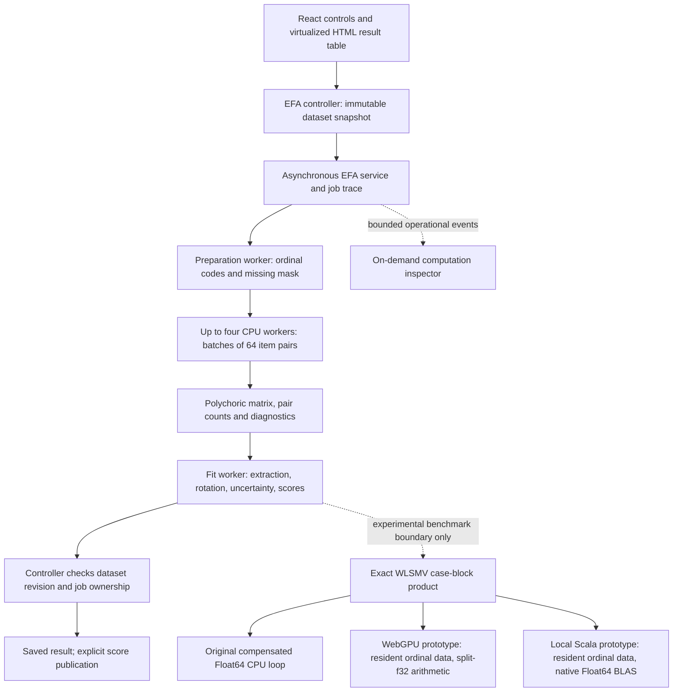

# EFA computation inspection and backend comparison

This work implements the agreed sequence: an inspector with shared benchmark
instrumentation, targeted WebGPU and Scala/JVM prototypes, then numerical and
performance comparison. In this phase the production estimator remains the
qualified CPU implementation. Numerical qualification is a prerequisite for
later integration of an accelerated backend into the application.

The follow-up [default-browser precision and optimization report](EFA-PRECISION-OPTIMIZATION.md)
records the no-developer-flags candidate and subsequent TypeScript/native
measurements. This report preserves the earlier successful and failed trials.

## Acceptance record

- [x] Explain virtualized HTML and CPU batching: a worker evaluates 64 pair
  tasks sequentially; up to four workers evaluate different batches.
- [x] Bounded session execution records and an on-demand inspector, with
  operational exports that exclude source cells, labels, category counts, and
  row membership.
- [x] Separate coordinator wall time, worker execution time, message round-trip
  time, measured sender postMessage time, and cumulative typed-buffer bytes.
- [x] Distinguish numerical completion from workspace result acceptance.
- [x] Browser verification in both themes, keyboard and narrow-screen checks
  (`frontend/scripts/efa-reference/inspector-ui-verification.json`).
- [x] Targeted WebGPU prototype with bounded dispatches and explicit precision.
- [x] Scala/JVM prototype, pinned compiler and BLAS dependencies, verified
  numerical backend and runtime provenance.
- [x] Identical saved kernel inputs for all backends; preserve hashes and results.
- [x] Numerical comparisons including difficult inputs and robust-inference
  outputs, not merely ordinary matrix products.
- [x] Cold/warm stage and end-to-end timings, memory qualification, browser
  responsiveness, and cancellation; full 500-item / 20,000-row workload.
- [x] Regression tests, TypeScript, build, lint regression gate, and a report
  distinguishing measured scope from extrapolation.

## Candidate boundary

The first candidate kernel is the robust case-space block product
`H_ab = A_a A_b' - Z_a Z_b'`. A contains weighted ordinal influence values;
Z contains their projection onto the fitted model's tangent space. Its diagonal
and squared Frobenius norm supply the WLSMV trace corrections. This targets an
actual expensive stage without changing the estimator or substituting PCA.

The CPU baseline retains compensated double-precision accumulation. WebGPU
precision and summation order are recorded and tested, with CPU double-precision
aggregation of returned blocks. Scala/JVM includes an explicit compensated-loop
baseline and native BLAS candidate, so language and library effects are visible.
The JVM executable is a local benchmark tool using public/synthetic fixtures;
it is not a server or a production data-upload path. Spark is not in this scope.



A batch of 64 is a scheduling unit. Each CPU worker loops through those pairs
sequentially; it does not create 64 CPU threads. Workers have separate JavaScript
execution contexts and communicate by messages. The current production service
copies its typed-array message payloads; it does not use shared-memory RDDs.
The result table mounts only the visible rows plus a small buffer. This HTML
virtualization reduces DOM work, independently of worker computation. Existing
2D plots use SVG and 3D plots use Plotly WebGL. The prototype does not change
those renderers or expose a production WebGPU selector.

Report kernel-only and complete-pipeline measurements separately. A small GPU
smoke check, a single block, a cancellation check, or a theoretical operation
count cannot qualify a completed full-size WLSMV fit. Do not silently omit
rotation-dependent uncertainty from an end-to-end WLSMV result.

The isolated browser pipeline harness runs the common numerical pipeline in one
worker; the Node harness runs the same TypeScript pipeline with an explicit local
JVM child for the candidate kernel. Production correlation scheduling uses up to
four workers. These harness timings compare the controlled prototype pipelines;
they are not measurements of every production UI interaction or a full Scala
rewrite. Kernel startup is reported separately from per-fit elapsed time.
Per-fit elapsed time starts at analysis preparation, after synthetic fixture
generation or reference-file loading. It does not measure uploading/parsing a
dataset, JVM compilation, or a user's complete workbench session.

## Inspector

`Compute` in the sidebar opens the inspector. It retains at most 20 recent jobs,
512 detailed events and 128 completed stage segments per job. Request totals
survive event eviction. Closing the inspector avoids report cloning and does not
cancel work. It has no respondent-data inspection API and no additional
assistant-facing endpoint. It does not create an alternate holdout fitting path.

These records describe this tab session; workspace persistence still stores
analysis specifications/results rather than transient performance logs. The
separately requested real development/holdout dataset lock remains pending and
must not be described as implemented by this inspector.

## Evidence (completed 2026-11-01 UTC)

The inspector browser check passed both themes, a 390px viewport, keyboard
focus containment and return, a real worker job, and diagnostic JSON export.
The updated unit suite passed 626 tests with four pre-existing intentional
skips. TypeScript passed; the lint regression gate passed with the existing
117 errors and six warnings and no added findings by file, rule, and severity.
Nine comparison-integrity checks passed, including rejection of truncated
scores, inconsistent masks, negative standard errors, nonconvergence, and
nonidentical inputs. Final check artifacts are listed in `completion-audit.json`.
The final isolated production build passed from
`/tmp/scatter-compute-build-final.t8zec6kn`, excluding temporary qualification
assets and environment files. Both-theme and mobile screenshots were also
visually inspected after the final UI wording change.

The kernel fixture generator creates 15 blocks from the five independently
R-qualified ordinal input datasets (diagonal, off-diagonal and ragged edges),
one synthetic block with 124,750 pair coefficients and 2,490 parameters, and
one near-cancellation stress block. Input and reference-output hashes are saved
in the generated manifest. They contain no participant data.

- Scala 2.13.16 on Java 21, with pinned `dev.ludovic.netlib:blas:3.2.0`, loaded
  `dev.ludovic.netlib.blas.JNIBLAS`. Both its compensated Float64 loop and native
  BLAS passed all 17 block fixtures at scaled absolute tolerance `1e-10`.
- The ordinary and compensated-source WGSL f32 candidates each failed one
  coefficient on the cancellation stress fixture at tolerance `1e-5`. Both
  failures are retained; do not describe these candidates as qualified.
- The revised split-f32 input / chunked host-f64 reduction candidate passed
  all 17 block fixtures at `1e-5`. Its maximum cancellation-stress error was
  approximately `3.99e-6`. This is a tested precision strategy, not native GPU
  Float64 arithmetic or a guarantee on every adapter.
- Complete case-space WLSMV pipelines passed all five independent R fixtures
  for browser CPU, split-f32 WebGPU, Node CPU, and a local Scala/BLAS child
  kernel. These include robust test corrections and all three rotations with
  differentiated-rotation standard errors. The JVM prototype replaces the
  block kernel; the surrounding pipeline remains TypeScript. It is not a
  full Scala reimplementation.

On this Apple M1 / 8 GiB machine, warm medians for the wide block were 518 ms
for browser CPU, 55.6 ms for the split GPU host call including packing and
transfers, and 5.66 ms for the resident native-BLAS kernel. The native number
excludes JVM startup, input decoding and IPC; the browser GPU number includes
host-device transport. Do not present their ratio as an application speedup.
The complete small fits were slower with GPU than CPU. Detailed repetitions,
hardware, outputs and numerical errors are retained in:

- `frontend/scripts/efa-reference/compute/browser-kernels.attempt-1.json`
- `frontend/scripts/efa-reference/compute/browser-kernels.json`
- `frontend/scripts/efa-reference/compute/scala-kernels.json`
- `frontend/scripts/efa-reference/compute/browser-pipeline.json`
- `frontend/scripts/efa-reference/compute/scala-pipeline.json`

The first full 500-item / 20,000-row Scala/BLAS trial was cancelled after
64 of 12,403 trace blocks. Each call expanded and transmitted about 260 MB,
repeating work that the standalone BLAS timing excluded. Its incomplete
evidence is retained in `scala-large.attempt-1.json`, `.progress.json`, and
`.memory.json`. No completed WLSMV statistic or full-fit speed claim comes from
that attempt. Its sampled process-tree RSS reached 1,920,647,168 bytes.

Both revised prototypes load the ordinal codes, influence lookups and model
projections once, then accept row-range requests. The CPU reference still uses
the original arithmetic. All five R pipelines and the cross-backend comparisons
of rotations, reproduced correlations, all reported standard errors, actual
score vectors and masks passed. The first resident GPU shader had a reserved-word
compile error; `browser-resident-pipeline.attempt-1.json` preserves that failure.

The full resident Scala/BLAS run has five factors and uses 128-row blocks and an explicit 1,536 MiB
CPU inference-planner budget. Its output and sampled process-tree memory belong
to `scala-large-resident.json` and `scala-large-resident.memory.json`. These are
distinct from the incomplete streamed trial. GPU experiments additionally enforce
a 1 GiB limit on owned GPU buffers; the planner estimate is not a combined peak
memory guarantee. Every full run includes all three rotations and their SEs.
Execution without a completed cross-backend comparison is labeled
`completed-unqualified`. The separate comparison report determines numerical
agreement; successful execution does not imply numerical acceptance.

The resident WebGPU full-size fit completed on 2026-11-01 in **2,889,918 ms
(48.17 minutes)** on this Apple M1 / 8 GiB machine, Chrome 156.0.8078.76.
It includes all three rotations, their differentiated standard errors, and
actual complete-response scores. Its execution record is `completed-unqualified`;
the subsequent full-size comparison **failed the robust-statistic tolerances**.
The executable worker SHA
matches the worker that passed all five R fixtures in
`browser-resident-qualified.json`.

| Full WebGPU fit stage | Elapsed minutes |
| --- | ---: |
| Preparation, correlations, ordinal uncertainty, and DWLS | 1.02 |
| Robust inference, including the GPU trace blocks | 35.24 |
| Oblimin uncertainty | 7.02 |
| Promax uncertainty | 1.43 |
| Varimax uncertainty | 3.44 |

The GPU kernel instrumentation recorded 12,403 calls, one source upload,
445,742,896 uploaded bytes and **1,571,582,246,912 readback bytes**. These are
cumulative traffic counts, not simultaneous memory use. Peak owned GPU buffers
were 701,198,608 bytes. The isolated Chrome process RSS sample peaked at
1,047,265,280 bytes over 2,888 samples, with no sampler errors. RSS and GPU
buffer counts measure different things and must not be added as independent
physical-memory estimates on this unified-memory machine.

The combined dispatch/wait/readback/host-reduction interval was 23.10 minutes;
GPU timestamp queries measured 15.84 minutes inside the compute passes. Their
difference is not a measurement of transfer time alone. These measurements
support separating readback and host reduction in the optimization experiments.
The browser's 50 ms heartbeat continued, with a largest observed gap of
454.6 ms. The post-fit termination call took 0.8 ms after another full-width
kernel dispatch; that is not a measurement of GPU command retirement. Raw
evidence is `browser-large-gpu-resident.json`.

After the browser process exited, the preserved native process group resumed
at `2026-11-01T00:41:55.216344Z`. Its recorded suspension lasted 3,254,850 ms.
The native run completed, including all rotations, standard errors, and scores.
Its wall time was 7,574,754 ms (126.25 minutes); subtracting the recorded pause
gives an **estimated active elapsed time of 4,319,904 ms (72.00 minutes)**.
This was an interrupted run, not an uninterrupted native timing. The raw
in-flight kernel timings may include the suspension and are not corrected.
No original JavaScript/CPU full-size baseline was launched.

The full GPU and native inputs have identical prepared-data fingerprints.
The default-browser GPU errors against native Float64 were approximately:

| Robust quantity | Absolute difference | Acceptance tolerance |
| --- | ---: | ---: |
| Trace | 0.000904 | 0.0001 |
| Trace of the squared product, tr((UΓ)²) | 0.004583 | 0.0001 |
| Shift | 0.000132 | 0.0001 |
| Adjusted statistic | 0.000811 | 0.0001 |

All three aligned rotations, factor correlations, communalities, reproduced
correlations, reported standard errors, and actual scores passed their checks.
That does not override the failed robust-statistic checks. The default split-f32
backend is **not numerically qualified for this workload**. No tolerance changed.

The exact archived native pipeline bundle was replayed against all five R
fixtures (`scala-full-bundle-reference.json`). Its pipeline, protocol, Scala
source, and compiled class hashes match the retained full-run artifacts.
This establishes the tested implementation's provenance; the 500-item synthetic
result is cross-backend evidence, not a separate full-size R result.

### Precision and data-movement experiments

`gpu-precision-default.json` preserves default-browser split, compensated-split,
and compensated/reduced experiments. All three failed the tighter `1e-10` kernel
check, while passing the older `1e-5` kernel threshold. Merely adding compensation
in shader source did not improve precision on this adapter.

With Chrome's explicitly enabled developer-only strict-math option,
compensated split arithmetic passed all 17 kernel fixtures at `1e-10`, both
with and without on-GPU reduction (`gpu-precision-strict.json`). The unrevised
split variant still failed. This identifies a tested experimental combination;
it is not evidence that standard/default WebGPU supplies these guarantees.

The reduced variant also passed ten resident-source cases, including missing
responses, repeated blocks, diagonals and ragged edges, against Float64 native
outputs at `1e-10` (`gpu-resident-strict-reduced.json`). Its largest absolute
difference was about `6.2e-14`. A representative 128-by-128 block took
83.0, 79.3, 81.8, 79.1 and 78.9 ms. Readback fell to **256 KiB per call**,
from 122 MiB per call, by combining partial sums on the GPU. These are kernel
measurements, not full-fit speedups.

The strict/reduced complete pipeline passed all five R fixtures in
`browser-strict-qualified.json`. Its full-size run completed in **2,460,329 ms
(41.01 minutes)** and passed the full numerical comparison with native Float64.
The largest robust-statistic difference was `8.964e-9`; trace and trace-of-square
differences were approximately `1.819e-10` and `2.037e-10`. The score, rotation,
communality, reproduced-correlation and uncertainty comparisons also passed.
The full worker hash matches the independently R-qualified worker.

| Strict/reduced WebGPU full-fit stage | Elapsed minutes |
| --- | ---: |
| Preparation, correlations, ordinal uncertainty and DWLS | 1.00 |
| Robust inference | 28.83 |
| Oblimin uncertainty | 6.71 |
| Promax uncertainty | 1.22 |
| Varimax uncertainty | 3.23 |

Readback was **3,220,455,424 bytes**, exactly 488 times less than the earlier
1,571,582,246,912-byte readback. The kernel recorded one source initialization,
12,403 calls, and 573,796,672 bytes of peak owned GPU buffers. Its combined
dispatch/wait/readback interval was 16.93 minutes, while GPU timestamps measured
16.44 minutes. The isolated Chrome RSS peak was 1,017,249,792 bytes over 2,459
samples with no sampling errors. The largest heartbeat gap was 714.6 ms; the
post-fit worker termination call took 1.4 ms. That cancellation measurement
does not establish when already-submitted GPU commands retired.

This is a successful **developer-only** experiment, not qualification of
default-browser WebGPU. The 41.01-versus-48.17-minute observation comes from
single full fits with changed arithmetic, reduction strategy and runtime
conditions; it is not a replicated causal speedup estimate. The first GPU run
also retained the suspended native process's memory. Environment details and
these limitations are saved in `environment.json`.

The native optimization variant lives in a separate
`TraceServerOptimized.scala`; the original measured source remains unchanged.
Its bounded kernel trials distinguish materialization and BLAS time and include
a separate repeated-kernel cancellation probe that measures actual JVM exit.

All six native configurations passed the ten saved resident cases on five
repetitions at scaled absolute tolerance `1e-10`. Warm results below are medians
of repetitions 2–5, each containing the same ten ranges in the same order.

| Native configuration | Requested BLAS threads | Warm ten-range median (s) | Materialization median (s) | BLAS median (s) |
| --- | ---: | ---: | ---: | ---: |
| Original resident baseline | 1 | 2.904 | Not separated | Not separated |
| Reused buffers, direct code access | 1 | 2.775 | 2.399 | 0.380 |
| Reused buffers, direct code access | 2 | 2.802 | 2.452 | 0.319 |
| Reused buffers, direct code access | 4 | 2.609 | 2.262 | 0.322 |
| Reused buffers and row-code cache | 1 | 3.360 | 2.723 | 0.477 |
| Reused buffers and row-code cache | 2 | 2.610 | 2.290 | 0.302 |
| Reused buffers and row-code cache | 4 | 2.431 | 2.107 | 0.297 |

The last configuration had the lowest observed median, approximately 16% below
the earlier baseline. It passed all five independent R pipeline fixtures in
`scala-optimized-qualified.json` and was selected for the native holdout refit.
These are small repeated kernel experiments on one host, not a measured
optimized 20,000-row full-fit speedup. Requested thread counts are environment
settings; actual BLAS thread counts were not observed. Phase medians need not
sum to the median total. The slower one-thread row-cache result is retained.

Block reconstruction accounted for approximately 87% of the selected workload's
warm median, versus approximately 12% for BLAS. This is evidence to investigate
lookup traversal and memory locality before adding another distributed scheduler.
A pair-first or tiled materialization traversal is a subsequent experiment,
not an implemented or measured improvement here.

All six actual-JVM-exit cancellation probes passed, ranging from approximately
178 to 642 ms after the repeated-kernel probe acknowledgement. Their scope
differs from the browser's worker-termination-call measurement. The complete
repetitions, numerical errors, memory samples and cancellation records are
retained in `native-reuse-*.json` and `optimization-comparison.json`.

### Completed holdout refits

Both candidates independently refitted the same saved 6,000-row holdout from
the synthetic 20,000-row dataset, with 500 items and five factors. Actual
14,000/6,000 development/holdout membership is recorded and compared, with
`afterFullExploration: true`. Both fits include all three rotations, full
rotation-dependent standard errors, and complete-response scores.

| Holdout candidate | Elapsed minutes | Sampled process RSS peak | Numerical comparison |
| --- | ---: | ---: | --- |
| Strict/reduced WebGPU, developer feature | 18.49 | 766.6 MiB | Passed |
| Optimized Scala/BLAS, row cache, four requested threads | 21.07 | 819.7 MiB | Passed |

The adjusted-statistic difference was `2.542e-8`; the largest standardized
score difference was `1.446e-9`, with identical complete-response masks.
All aligned loadings, factor correlations, communalities, reproduced matrices,
and standard errors passed their unchanged tolerances. Source bundle, native
bytecode, protocol, options and thread-request provenance match the respective
five-fixture R qualifications. The records are
`browser-holdout-gpu-strict-reduced.json`, `scala-holdout-resident.json`, and
`comparison.json.holdoutComparison`.

The GPU holdout heartbeat's largest gap was 309.5 ms; its worker termination
call took 0.6 ms. These remain browser responsiveness and termination-call
measurements, not GPU command-retirement measurements. Both RSS samplers had
zero errors. These synthetic performance refits do not implement the separate
dataset lock or establish independent model validation.

`comparison.json` deliberately retains the overall status `numerical-failures`:
the default-browser candidate failed, while the strict-math full-size and
holdout candidates passed. Successful experimental comparisons do not promote
any backend into production.

After the full fits, a lint-only rename changed the shader factory's local
JavaScript identifier from `module` to `createShaderModule`. The rebuilt worker
passed all five R fixtures in `browser-lint-clean-qualified.json`. Full-fit
reports still identify their original immutable archived worker bytes; the
cosmetic rename is not presented as another full-size run.

## Reproduction

Run these from `frontend/`. Start the development server with `dev start
frontend --detach --json --yes` from the repository. Public benchmark assets
under `public/efa-qualification` are temporary and must be removed or excluded
before deployment; the isolated production build excludes them.
Use a scratch checkout or new explicit output paths when repeating experiments:
the retained reports include failed attempts and measured baselines and must not
be overwritten by a later run. The continuation coordinator refuses existing
outputs; the lower-level scripts also support isolated report destinations.

```sh
node scripts/efa-reference/check-inspector-ui.mjs
node scripts/efa-reference/compute/bootstrap-scala.mjs
node scripts/efa-reference/compute/build.mjs
node /tmp/scatter-compute-generate.mjs
node scripts/efa-reference/compute/check-scala.mjs
node scripts/efa-reference/compute/check-browser.mjs
node scripts/efa-reference/compute/check-pipeline.mjs
node scripts/efa-reference/compute/check-scala-pipeline.mjs
```

Run timing experiments sequentially to avoid benchmark contention. The kernel
browser command deliberately exits nonzero when the rejected f32 candidates
fail; inspect per-candidate results rather than treating the whole file as a
passing GPU qualification. Full-size jobs use the explicit `--large` flag or
browser `?pipeline=true&fixture=large&backend=...` parameters. They are never
triggered by ordinary app controls.

For the resident full-size trials:

```sh
node scripts/efa-reference/compute/check-pipeline.mjs 'http://localhost:3000/efa-qualification/compute/index.html?pipeline=true&fixture=large&backend=gpu-resident&block=128&budgetMiB=1536' scripts/efa-reference/compute/browser-large-gpu-resident.json
node scripts/efa-reference/compute/run-monitored.mjs scripts/efa-reference/compute/scala-large-resident node scripts/efa-reference/compute/check-scala-pipeline.mjs scripts/efa-reference/compute/scala-large-resident.json --large --block=128 --budget-mib=1536
```

The holdout performance refit uses `--fixture=large-holdout` for the local JVM
harness or `fixture=large-holdout` in the browser URL. It generates the same
20,000-row dataset, creates a 70/30 split with seed 93821, and saves the actual
development and holdout row arrays in the result. Only the 6,000 holdout rows
enter preparation, thresholds, fitting, scaling, or scoring. This is a synthetic
performance experiment after full-data fitting, not evidence of independent
model validation or an implementation of the requested dataset lock.

The original JavaScript/CPU full-size baseline is a separate run from the
Scala/native-BLAS CPU prototype. The user's latest instruction on 2026-10-31
supersedes the earlier completion request: **skip that baseline for now, run
WebGPU before finishing native, then investigate optimizations after both**.
No full-size JavaScript baseline was started. Its prospective duration remains
an extrapolation from block timings. `backend=cpu&timeoutMinutes=0` remains an
explicit reproduction option, with zero disabling the observation deadline;
it is not in the active execution sequence.

The live native process group was suspended with its work retained in memory;
`scala-large-resident.suspension.json` records the timing interruption. Its wall
time and in-flight kernel timing include the suspension and must not be presented
as uninterrupted computation. The waiting serial coordinator was stopped before
it launched any child workload. Stage percentages (for example, completed trace
blocks) are not percentages of the entire fit, which also includes rotation
uncertainty and scores.

## Backend portability and optimization after the baseline trials

Retain both candidate adapters. A future product selection should distinguish
WebGPU from native CPU/BLAS and record the actual backend, precision strategy,
device/runtime, numerical self-checks, and resource limits. Automatic selection
should use capability detection and a short representative measurement, with a
manual override. A backend that fails numerical checks is not eligible for
automatic selection. These are deployment recommendations, not a claim that
the app already exposes a working native-runtime selector.

WebGPU is browser-native but its availability, buffer limits, driver behavior,
and speed vary by device. Native BLAS provides Float64 computation on CPU-only
or CPU-heavy systems but requires a JVM/local companion or desktop packaging;
the present application cannot execute the Scala process inside a browser tab.
No remote participant-data upload is authorized by this prototype comparison.

Practical selection should depend on the measured workload and machine:

| Situation | Candidate to investigate first | Qualification needed |
| --- | --- | --- |
| Browser-only use on a capable GPU | WebGPU | Standard-browser precision, buffer limits, device loss and full output parity |
| CPU-heavy workstation or GPU unavailable/disabled | Native BLAS | Local installation, supported BLAS library, actual thread behavior and memory |
| Small item battery | Existing browser CPU | Startup and transfer overhead can outweigh kernel savings |
| Low-memory laptop/mobile browser | Bounded browser CPU or smaller job | A GPU's presence does not imply sufficient memory or a stable fit |
| Many independent resamples/refits | A bounded local queue first | Avoid nesting worker parallelism and BLAS threads; distributed scheduling only if measured need remains |

The present GPU precision result prevents offering it as an interchangeable
default-browser production backend. A product switch must select only qualified
implementations and explain unavailable choices. Keep the prototype adapters
available for testing without implying that a browser can start the Scala child.

The current [WGSL floating-point rules](https://www.w3.org/TR/WGSL/#floating-point-evaluation)
permit reassociation and define `fma` accuracy through a multiply-add expression,
so a source-level compensated sum or split representation is not a portable
Float64 guarantee. The existing ordinary and compensated f32 trials returned
identical outputs on this adapter; that observation does not itself identify
the compiler transformation responsible. Chrome's documented
[`strictMath` option](https://developer.chrome.com/blog/new-in-webgpu-131#shader_module_compilation_option_strict_math)
is a developer feature, absent from the current standard WebGPU descriptor.
A developer-flag experiment must remain distinct from a deployable browser
backend and must not be counted as default-browser qualification.

The original native experiment requested one BLAS thread in a single JVM;
the completed optimization experiment requested one, two, and four threads.
The production app's correlation pool uses up to four local browser workers.
Neither is a distributed cluster. [Dask](https://docs.dask.org/en/stable/)
would add Python orchestration. [Spark RDDs](https://spark.apache.org/docs/latest/rdd-programming-guide.html)
provide partitioned, fault-tolerant distributed collections for Scala and other
languages. Neither automatically fixes the measured block-reconstruction and
GPU-readback costs. Independent resamples are a more natural future unit of
distributed scheduling than individual small matrix blocks.

The completed experiments and remaining optimization priorities are:

1. Separate end-to-end stage costs from kernel costs, and retain numerical and
   performance evidence for each change.
2. Native buffer reuse, row caching and requested BLAS thread counts were tested
   above. Bounded concurrent blocks remain a separate experiment. Avoid
   multiplying both forms of parallelism unintentionally.
3. The strict GPU experiment reduced measured readback 488-fold while retaining
   the numerical tolerances. Default-browser precision remains unresolved;
   solve that portability requirement before exposing a product selector.
4. Profile the shared TypeScript projections, covariance transforms, and
   differentiated-rotation uncertainty. Kernel acceleration alone leaves them.
5. Tune block sizes, buffer reuse, and concurrency to memory limits. Preserve
   exact inference and explicit failures; do not gain speed by dropping SEs or
   silently changing estimators.
6. Consider distributed scheduling for independent simulation/refit jobs only
   after single-machine computation and data movement have been measured.

The completed strict GPU fit spent 16.93 of its 41.01 minutes in the measured
dispatch/wait/readback interval. Accelerating that kernel further therefore
leaves substantial work elsewhere. Source inspection identifies concrete next
experiments, not yet measured speedups:

- `weighted-inference.ts` builds the case projections by traversing item pairs
  first and updating the many separate respondent vectors. Compare this with
  a row/block traversal and compact precomputed sparse Jacobian entries. Keep
  each respondent's accumulation order fixed where possible; measure the added
  lookup storage rather than expanding all respondent-by-pair influences.
- The triangular solves, `Z'Z` covariance accumulation, and covariance matrix
  products are candidates for bounded Float64 BLAS operations in the native
  adapter. These are currently shared TypeScript work, not Scala acceleration.
- `weighted-rotation.ts` evaluates the complete rotation map repeatedly and then
  computes each derivative vector's covariance quadratic form. Profile these
  two parts separately; a faster covariance product does not remove rotation
  differentiation. Preserve full rotation-dependent standard errors.

Each proposed replacement needs the same independent R and complete-output
checks. No estimator substitution, omitted uncertainty, changed tolerance, or
unmeasured whole-application speedup is implied by these suggestions.
