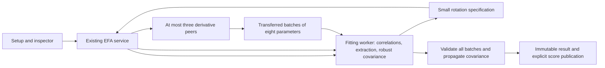

# Trace throughput and parallel rotation derivatives

This follows the checkpoint commit `d8bf5db` and the [portable precision qualification](EFA-PRECISION-OPTIMIZATION.md). The checkpoint was committed locally before these changes; it was not pushed. The full JavaScript CPU baseline remains skipped at the user's request. Every fixture in this work is synthetic or public.

## Execution changes

The application now computes WLSMV rotation derivatives using its existing bounded worker service. `fitEfaSteps` pauses after the robust covariance has been computed. The fitting worker retains that covariance, respondent data, and the fit continuation. It sends only an identified loading matrix, free parameter indices, reference pattern, rotation method, and seed to the coordinator. Up to three peer workers join the fitting worker, respecting available hardware and the four-worker limit.

Each task contains eight parameters. Each parameter still requires four complete rotations: plus/minus the original step and plus/minus half that step. The workers retain four deterministic rotation starts, the strict varimax convergence tolerance of `1e-14`, the relative half-step stability threshold of `.005`, Richardson extrapolation, and sign/permutation matching only. Nothing is aligned with an additional continuous rotation.

Workers return parameter-major `Float64Array` batches by transfer. The fitting worker validates dimensions, finite values, ranges, and duplicate delivery before copying each column into its original parameter position. Covariance propagation starts only when every parameter has arrived. Failed or incomplete work cannot produce standard errors. Cancellation terminates all owned workers; existing job-revision and publication guards remain in effect. The inspector records derivative requests, worker activity, and transferred payload bytes. Covariance and respondent arrays are not replicated into derivative workers.

The synchronous `fitEfa` API remains available for existing callers. MICE and stability jobs retain their existing scheduling rather than creating nested derivative pools. The browser and Scala qualification pipelines use the same derivative implementation, with a coordinator and up to three peers (`Worker` in the browser, `worker_threads` in Node). The numerical engine identifier is `scatter-efa/6`.



## Trace candidates

The selected default-browser portable kernel uses 1,024-element dot chunks instead of 256. The 16×16 compute workgroup and 256-thread reduction are unchanged. The host buffer dimensions and shader chunk indexing use the same validated option. Larger chunks reduce intermediate storage and reduction traffic while retaining explicitly rounded split-f32 arithmetic.

The resident synthetic workload (20,000 rows, 500 items, 2,490 projection parameters) retained ten ranges including missing responses, diagonal/off-diagonal blocks, ragged tails, and revisits after ragged blocks. The sum of warm per-range medians was 987.40 ms for a fresh 256-chunk trial, 964.85 ms for 1,024, and 972.40 ms for 2,048. These are short single-machine observations, not precise cross-device speed estimates. The largest owned buffer footprint fell from 573,796,672 to 477,851,968 bytes with 1,024. All ranges passed the unchanged scaled `1e-10` error threshold.

Two other GPU experiments are retained but not selected: expanding/caching full row panels used more memory without a clear benefit, and sharing significand decomposition within tiles was slower. Both passed their numerical checks. Their explicitly requested harness options are `panels` and `preSplit`; neither is enabled by default.

The Scala candidate `TraceServerPanel.scala` extends the previously qualified pair-tiled row-major implementation to 256 rows per block. It retains the same native BLAS operations and bounded buffers. A 256-row result is compared against the original implementation's 128-row tiles at scaled `1e-10`. The planner accepts an explicit block size up to 256, still enforcing its existing allocation budget; the application's default block size is unchanged. The final sequential paired native microbenchmark measured warm medians of 2,568.69 ms for the 128-row tiled reference and 1,407.90 ms for 256 rows (three repetitions each, excluding the first from the median). Every comparison passed; the owned JVM exited 177.13 ms after the 256-row cancellation probe was acknowledged. Earlier tuning runs, including a contended attempt, remain retained.

The full-size candidate uses an explicit 1,536 MiB inference estimate budget. Process RSS and buffer accounting are reported separately, not added as a physical-memory total.

## Provenance and numerical gates

Qualification preserves the independent R fixtures, full-result tolerances, input fingerprints, complete score vectors and masks, convergence records, and factor matching rules. It additionally compares the derivative worker executable hashes, pool configuration, and trace chunk/panel settings. The rejection tests cover missing derivative executables/records, changed concurrency, and unqualified trace settings.

Browser runs archive the parent and derivative worker executables. The derivative source is sent as immutable data to the coordinator, hashed there, and instantiated from a Blob URL. The first two short R attempts passed all numerical comparisons but failed the executable-delivery gate because browser request interception did not observe nested worker loads; both failed reports are retained. The Blob-delivery run passed the complete gate. Node runs separately archive the parent, derivative worker, pool, binary protocol, Scala source, and native bytecode hashes; derivative worker files are named by content hash.

The complete numerical and timing sequence is `frontend/scripts/efa-reference/compute/qualify-throughput.mjs`. It runs WebGPU first, then Scala, sequentially, with complete full-size and saved 6,000-row holdout fits. Each fit includes all three rotations, full rotation-dependent standard errors, and complete-response oblimin scores. It compares against the saved pre-change native outputs and stops on any failed gate. The holdout rows are the exact saved membership; this is a performance/structure computation check, not a validation claim.

## Regression evidence

The application regression report is `throughput-regression-v3.json`: 637 tests passed, four existing skips, TypeScript, an isolated production build, both theme workflows, inspector checks, refits, scores, and workspace reload. Lint retains the same 117 errors and six warnings with no increased file/rule/severity counts. The first unrestricted test run hit the existing five-second limit on the heavy-tail reference test while other validation work was active; the full suite passed with two test workers, without changing the timeout or numerical criteria. Both reports are retained.

Twelve portable provenance/output rejection checks and nine shared comparison rejection checks passed. New production-worker tests cover exact serial/parallel uncertainty agreement, reused correlations, cancellation during derivatives, peer failure, bounded concurrency, and telemetry. The pure derivative tests cover out-of-order delivery for all rotations and malformed, duplicate, incomplete, and wrong-range work.

## Availability

WebGPU and Scala remain available as explicit qualification backends. These accelerators have not been added to the normal application's backend selector: a production selector still needs per-device self-checks and the Scala local-companion lifecycle. The application change in this phase is parallel browser-CPU rotation derivatives. Separate locked holdout datasets remain a separate unfinished feature.

## Reproducing the two backends

Start the server using `dev start frontend --detach --json --yes` from the repository root. Run the following from `frontend/`, using fresh output filenames. These commands run the five small R fixtures; add `fixture=large` to the browser URL or `--fixture=large` to the Scala command for the full-size workload.

```sh
node scripts/efa-reference/compute/build.mjs
node scripts/efa-reference/compute/check-pipeline.mjs 'http://localhost:3000/efa-qualification/compute/index.html?pipeline=1&backend=gpu-portable-reduced&block=128&budgetMiB=1536&rotationWorkers=4' /tmp/efa-webgpu-recheck.json
node scripts/efa-reference/compute/check-scala-pipeline.mjs /tmp/efa-scala-recheck.json --source=scripts/efa-reference/compute/TraceServerPanel.scala --class=TraceServerPanel --threads=4 --block=256 --budget-mib=1536 --rotation-workers=4
```

The Scala harness uses the locally pinned dependencies installed by `bootstrap-scala.mjs` and requires a native BLAS implementation. It does not silently fall back to Java BLAS. A browser without an eligible WebGPU adapter or sufficient buffer limits fails explicitly. Neither command sends analysis data to an assistant provider.

## Full-size measurements

The retained sequence report `throughput-sequence-v3.json` is **qualified**. The combined source/evidence audit `throughput-completion-audit-v3.json` is **qualified-and-regression-passed**. All four fits completed and passed the unchanged full-output comparison gates.

| Backend and sample | Retained checkpoint | New run | Trace stage, before → after | Rotation derivatives, before → after |
|---|---:|---:|---:|---:|
| WebGPU, 500 × 20,000 | 39.74 min | **31.06 min** | 24.69 → 22.95 min | 9.67 → 2.71 min |
| WebGPU, 500 × 6,000 holdout | 14.14 min | **7.07 min** | 2.20 → 2.18 min | 9.48 → 2.59 min |
| Scala/BLAS, 500 × 20,000 | 34.69 min | **17.22 min** | 18.27 → 8.21 min | 10.81 → 4.06 min |
| Scala/BLAS, 500 × 6,000 holdout | 14.71 min | **7.19 min** | 1.34 → 0.76 min | 10.91 → 4.16 min |

These are single-machine observations on an Apple M1 with 8 GiB RAM. The current runs were sequential, with no simultaneous benchmark or test workloads. They are not a controlled causal estimate: Chrome changed from 156.0.8078.76 in the checkpoint to 156.0.8078.80; Node remained v26.8.1. The fresh trace microbenchmarks are a narrower comparison of the kernel candidates. Derivative totals exclude covariance propagation; whole-fit totals include it and all three rotations and scores. Compilation and browser/JVM startup are outside the fit timer.

The full-size native source initialization took 3.67 seconds, block materialization 199.73 seconds, and BLAS 283.57 seconds. The full-size GPU kernel dispatched 12,403 blocks, uploaded 445,941,344 bytes, read back 3,220,455,424 bytes, and initialized its resident source once. The native kernel dispatched 3,160 blocks and likewise initialized its resident source once. The four-worker rotation limit includes the coordinator; three peer workers are created.

The native full and holdout comparisons match retained loadings, communalities, factor correlations, scores, and every standard error exactly. The full robust statistic differs by `1.46e-11`; the holdout statistic matches exactly. For WebGPU, the full/holdout maximum standard-error differences are `4.94e-7` and `6.15e-7`, standardized score differences `1.24e-9` and `1.45e-9`, and corrected-statistic differences `8.83e-9` and `2.55e-8`. All are within the original gates. Both holdout comparisons verify the actual saved membership.

| Sampled summed process RSS | Checkpoint | New run |
|---|---:|---:|
| Browser full fit | 1.048 GB | 1.262 GB |
| Browser holdout fit | 0.988 GB | 1.377 GB |
| Native full fit | 0.833 GB | 1.402 GB |
| Native holdout fit | 0.744 GB | 1.124 GB |

The throughput improvement comes with higher sampled process RSS. GPU-owned buffers fell from 573.80 MB to 477.85 MB; this does not imply lower total physical memory. RSS can double-count shared pages and can miss short-lived peaks, and it must not be added to GPU-owned buffer accounting. The 256-row full inference plan estimates 1,592,448,724.8 bytes against its explicit 1,610,612,736-byte budget; that estimate is not a measured hard cap.

The full and holdout browser heartbeat maxima were 387.2 ms and 178.3 ms. Their post-fit worker-termination calls measured 0 ms at the timer's resolution and 0.5 ms, respectively. Those measurements do not establish GPU command-retirement latency. The separate native 256-row probe measured actual owned-process exit in 177.13 ms. Production-worker tests independently reject publication after cancellation or peer failure.

The final audit rebuilt five executable bundles and matched every hash to the qualified archives; it verified seven compressed archives and seven production modules against the source copy used by the passing production build. Post-run source cleanup changed only indentation/comments, confirmed by identical TypeScript output with comments removed. Full input/score vectors, rejected experiments, failed provenance attempts, versions, timings, memory observations, and comparison reports remain retained in `frontend/scripts/efa-reference/compute/`.

